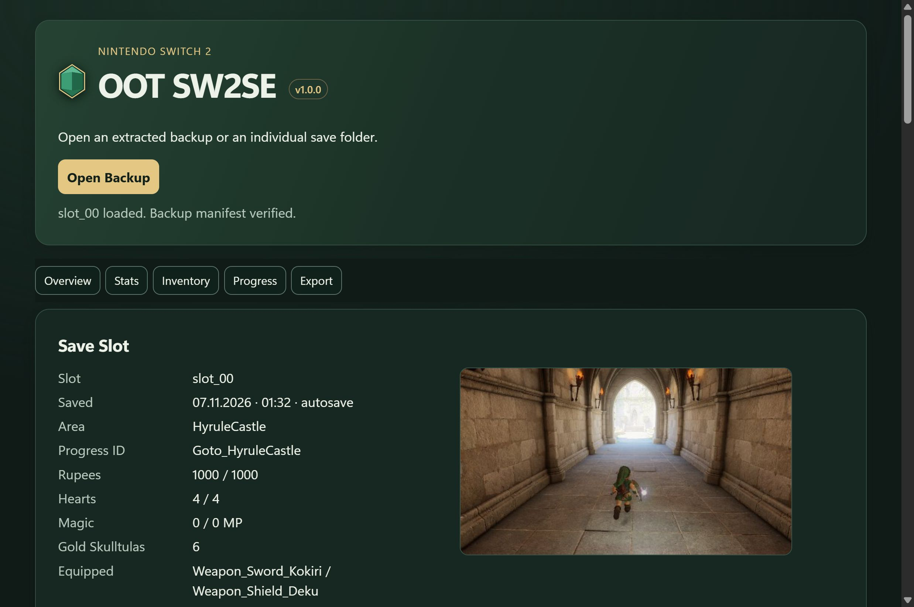

# OOT SW2SE

Save editor for the Nintendo Switch 2 remake of The Legend of Zelda: Ocarina of Time.

- Edit rupees, wallet size, hearts, and magic.
- Change item quantities, bottles, small keys, and bag or quiver capacity.
- Add missing items, including masks, with their acquisition flags set automatically.
- Toggle progress flags and change the spoken dialogue language when `option.sav` is available.
